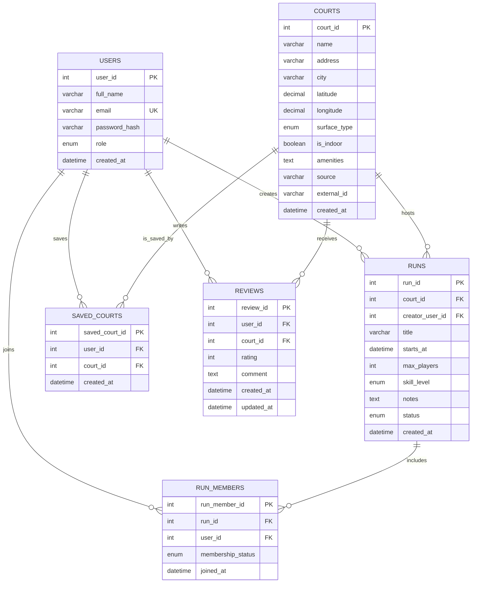

# COURTSIDE — Draft Entity-Relationship Diagram (Milestone 1)

This is a planning artifact only. The schema should be reviewed before the MySQL implementation in Milestone 2. The six planned entities exceed the course minimum of five.

## Relationships and constraints to implement later
- One user can create many runs; each run has one creator and is hosted at one court.
- A run has many members and a user can join many runs. `run_members` resolves the many-to-many relationship. Add a unique constraint on `(run_id, user_id)`.
- Users can save many courts and each court can be saved by many users. `saved_courts` resolves the many-to-many relationship. Add a unique constraint on `(user_id, court_id)`.
- A user can write multiple reviews and a court can receive multiple reviews. Consider a unique constraint on `(user_id, court_id)` if only one review per user/court is allowed.
- `users.email` should be unique; `users.role` should be restricted to `player` and `admin`; `reviews.rating` should be constrained to 1–5; `runs.max_players` must be positive.
- Court source fields (`source`, `external_id`) can identify MapLark/OSM-derived records and help avoid duplicate imports. Confirm the exact provider identifiers when integrating the API.
- Use foreign keys and deliberate `ON DELETE` behavior in Milestone 2. Avoid silently cascading user deletion into records that need an audit/history.

## Notes
- Store only a password hash, never a plaintext password.
- Store timestamps consistently; document timezone handling for scheduled runs.
- Keep this draft aligned with any changes agreed with the instructor before implementing SQL.
